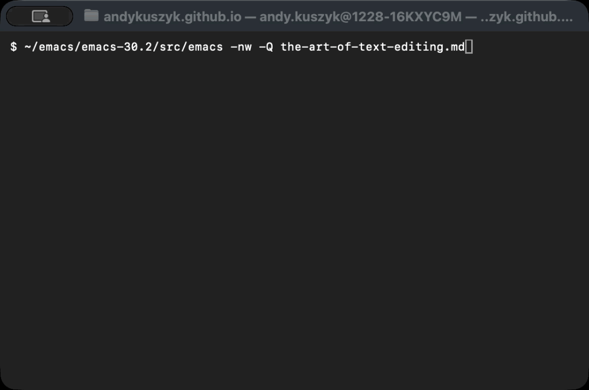
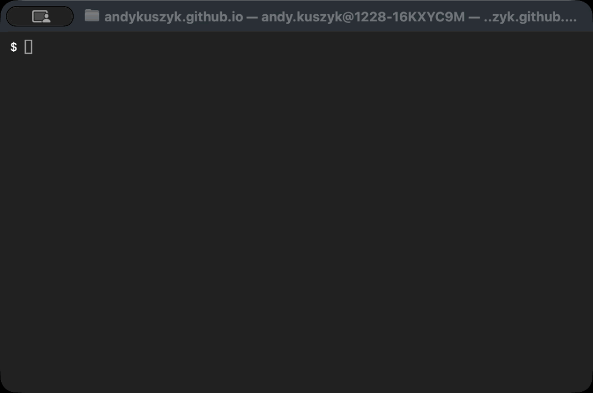
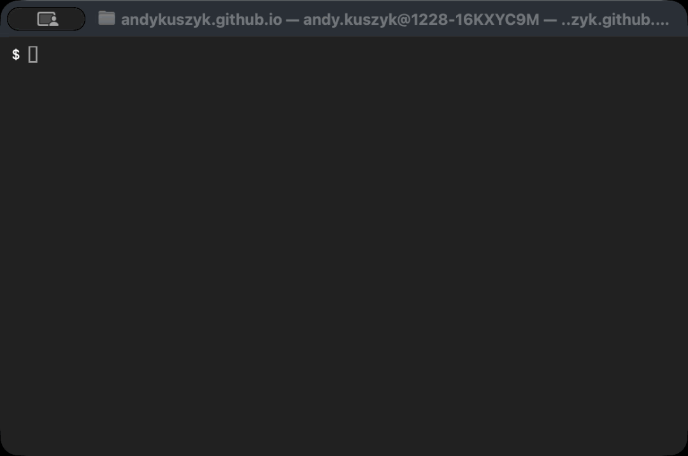
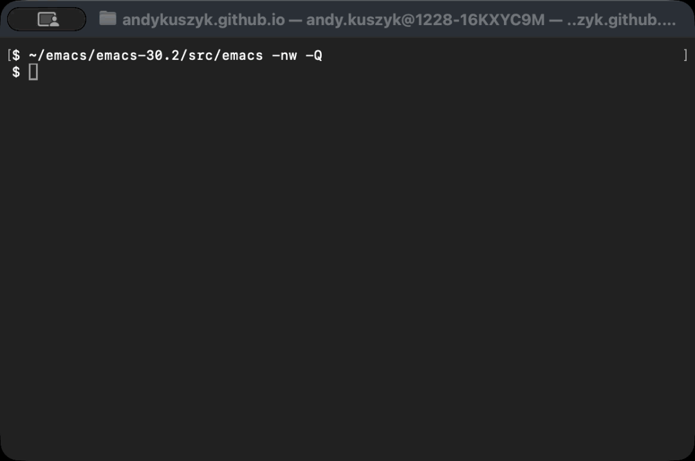

:PROPERTIES:
:UNNUMBERED: t
:END:
#+options: toc:nil stat:nil todo:nil
* Plantuml theme                                                   :noexport:
#+name: plantuml-theme
#+begin_src plantuml :file template.org-plantuml-theme.png :exports none
!theme crt-green
skinparam backgroundColor transparent
#+end_src
* The Art of Text Editing in the AI Age: Reading a file
Reading a file is probably the most fundamental skill when it comes to editing text files. Before you can insert, search, edit, or otherwise manipulate a file, you need to be able to read it.

In the age of AI, you might be thinking: /"why do I need to worry about reading files?"/ You can just open in them in your editor, IDE, or browser—or ask AI questions about the contents.

But the thing is, reading files is a /ubiquitous/ habit of anyone writing software. If you counted the number of times you open a file in a day/week/year, I suspect it would be very often!

Whilst there are a plethora of ways to open files, understanding how to do so in some foundational tools introduces you to the /bedrock/ of the text editing experience.

In this post, I'm going to cover how to read files in Vim, Emacs, and the Linux command line. Since this is also the first post in a [[file:the-art-of-text-editing.md][series about text editing]] with these tools, I'm also going to cover how to find interactive help for these tools as well.
** DONE Reading a file [3/3]
CLOSED: [2026-08-13 Thu 14:42]
*** notes                                                          :noexport:
terminal size was shell -> edit title, 80x24
*** DONE Vim
CLOSED: [2026-08-13 Thu 14:03]
Reading a file in Vim is simply a case of starting the program from a terminal, and providing the file path as an argument. In order to avoid using custom configurations of Vim, all the Vim commands in these posts will use the =--clean= argument which ensures it starts with defaults only.

To read a file in Vim, run:

#+begin_src bash
vim --clean <file-path>
#+end_src

Now you've opened the file, you probably want to navigate it, search it, and edit it. But all those things will be covered in future [[file:the-art-of-text-editing.md][posts]]! For now, the most important thing to know is how to /exit/ Vim. You do this by opening the Vim command line with =:=, and entering =q=:

#+begin_src bash
:q
#+end_src
*** DONE Emacs
CLOSED: [2026-08-13 Thu 14:25]
Reading a file in Emacs is very similar in principle to Vim. You can simply start it in a terminal, providing the file path as an argument. In these examples I'm going to use the =-nw= flag to launch Emacs in a terminal, and the =-Q= flag to avoid loading any user-specific config:

#+begin_src bash
emacs -nw -Q <file-path>
#+end_src

Once you're in Emacs, you can quit with the following key binding:

#+begin_src bash
C-x C-c
#+end_src

In Emacs parlance, the prefix =C-= stands for the control key. So this key binding is /Control-x/ followed by /Control-c/.
*** DONE Linux command-line
CLOSED: [2026-08-13 Thu 14:31]
Reading a file on the Linux command-line is just as easy as in Vim and Emacs, but with a few more options. One can use =cat= to read the whole file, =head= to read the start of the file, or =less= to page through the file:

There will be more on using =head= and =less= to navigate files in [[file:the-art-of-text-editing.md][future posts]]. One thing to note on =less= is that exiting the pager requires a special command: =q= in this case.
** DONE Getting Help [3/3]
CLOSED: [2026-08-13 Thu 17:50]
*** DONE Vim
CLOSED: [2026-08-13 Thu 17:22]
Help can be found in Vim using the command-line. Introductory help can be found from =:help=, and specific help can be found by searching for a keyword, e.g. =:help scrolling=.

Entering =:= activates the Vim command-line, =help= is a command, and =scrolling= is an argument:

As with a file, =:q= can be used to close a help screen. In Vim parlance, this quits the current /window/. More information in Vim windows can be found by running =:help windows=.
*** DONE Emacs
CLOSED: [2026-08-13 Thu 17:43]
Emacs as its own, similar help system called /info/. This is actually part of a wider general-purpose manual system similar to Manpages.

The info system can be launched in Emacs with:

#+begin_src bash
M-x info
#+end_src

This keybinding is also specific to Emacs parlance. =M-= stands for the /meta/ or /alt/ key, so =M-x= means =Alt-x= on modern keyboards.

More usefully, you can read a specific manual with =M-x info-display-manual=:

*** DONE Linux command-line
CLOSED: [2026-08-13 Thu 17:50]
As for the Linux command-line, help is abundant via Manpages. In order to view the "Man" manual for a command, just run =man=. E.g. =man cat=:

Running =man= just let's you read the file containing the manual, which generally uses =less= as a pager. As a result, any tips you pick up for reading files with =less= will also work for =man=.
** The art of...reading files!
So there are three simple ways to read files: in Vim; in Emacs; on the Linux command-line.

This post has introduced the fundamentals of using these tools, and [[file:the-art-of-text-editing.md][future posts]] will build on this foundation to cover searching files, editing files, and more. Happy editing!
