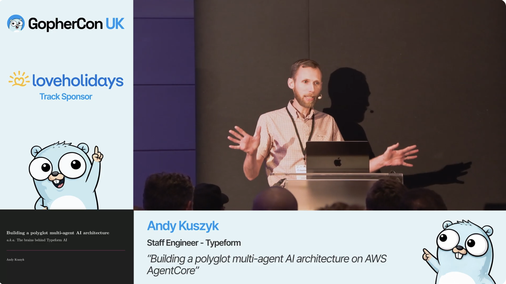
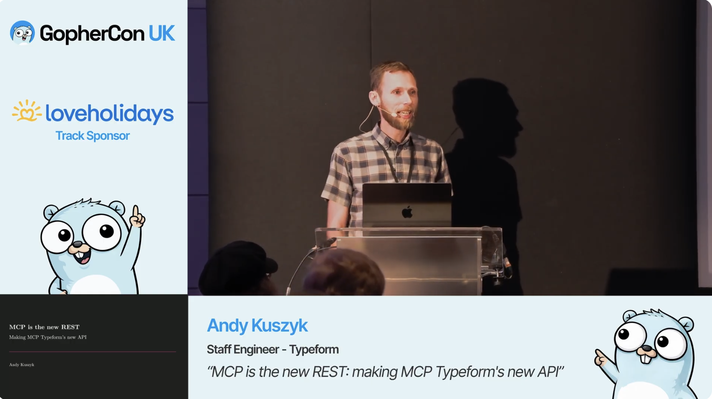
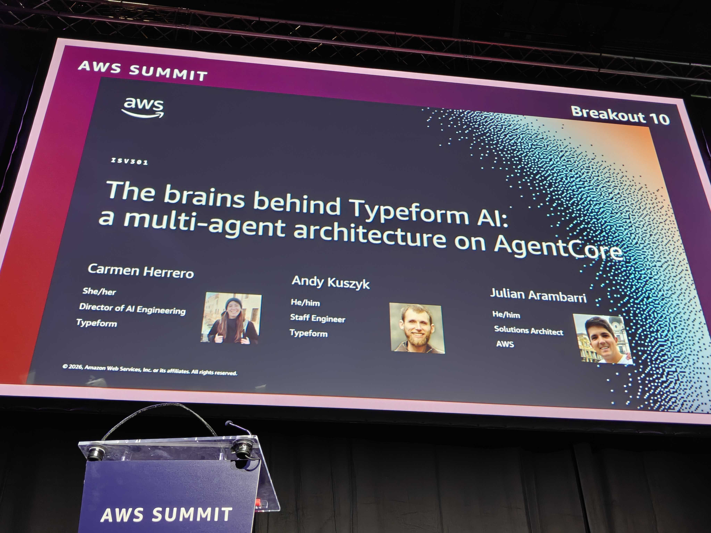
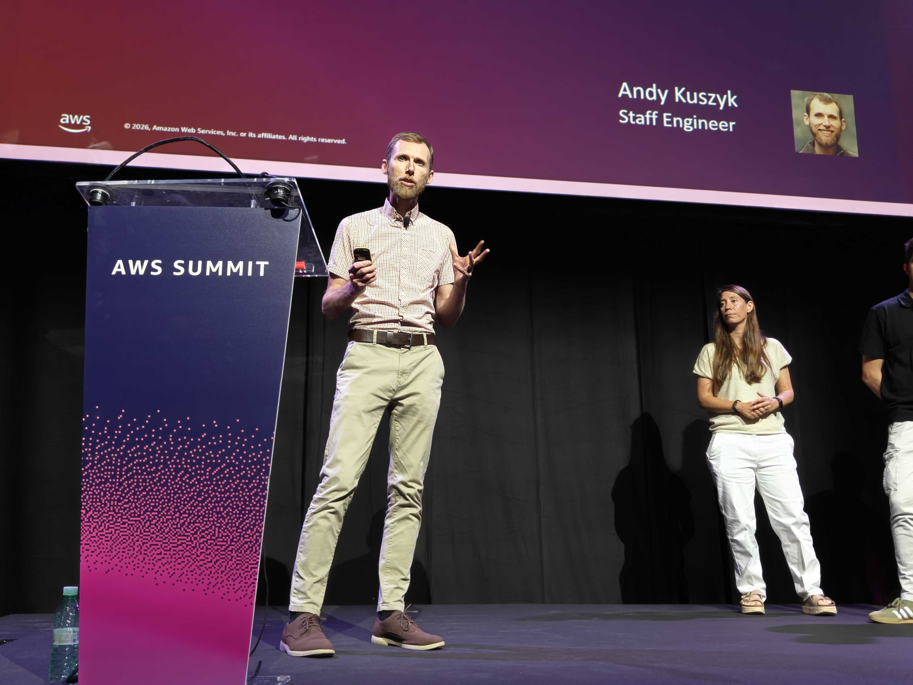
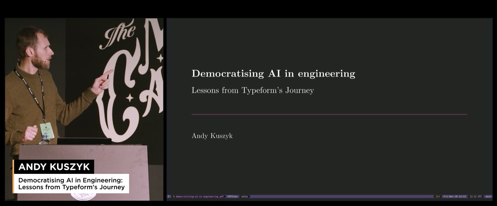

:PROPERTIES:
:UNNUMBERED: t
:END:
#+options: toc:nil stat:nil todo:nil
* Conference appearances
I enjoy sharing my ideas and experiences, and have recently started speaking at conferences. If you'd like to get in touch about speaking opportunities, please reach out on [[https://www.linkedin.com/in/andy-kuszyk][LinkedIn]].
-----
* Building a polyglot multi-agent AI architecture on AWS AgentCore
** GopherCon UK, 13th June 2026
:PROPERTIES:
:ID:       73EE1F8A-0DBB-4C82-A172-3D15D3A74F5C
:END:
On the second day of GopherCon UK '26, I spoke about building a multi-agent AI architecture at Typeform; including some of the design decision, Conway's Law, and solving the problem of durable execution.

#+DOWNLOADED: screenshot @ 2026-08-28 16:40:38

The full recording can be found on [[https://www.youtube.com/watch?v=-48cwqiT3Wc&list=PLGZGLmEvGK8I&index=20][YouTube]].
-----
* MCP is the New REST
** GopherCon UK, 12th June 2026
:PROPERTIES:
:ID:       66F8E23F-1C5B-4BCC-BBE1-1FA55DA0AD66
:END:
On the first day of GopherCon UK '26, I presented an expanded and updated version of my "MCP is the new REST" talk.

#+DOWNLOADED: screenshot @ 2026-08-28 16:39:30

The full recording can be found on [[https://www.youtube.com/watch?v=4EK3usamWOc][YouTube]].
-----
* The Brains Behind Typeform AI
** AWS Summit Madrid, 4th June 2026
At the 2026 AWS Summit in Madrid, I co-presented on behalf of Typeform with [[https://www.linkedin.com/in/carherrero/][Carmen Herrero]] about the "brains behind Typeform AI"—or how we built a multi-agent AI system capable of operating across Typeform's product surface.

I also published a blog post on the same topic on the [[https://medium.com/typeforms-engineering-blog/the-brains-behind-typeform-ai-6e885f47159b][Typeform engineering blog]].

Unfortunately, talks were not recorded at the conference.
-----
* MCP is the New REST
** SREday London, 12th March 2026
In the Spring of 2026, I [[https://sreday.com/2026-london-q1/Andy_Kuszyk_Typeform_MCP_is_the_new_REST_making_MCP_our_new_API][spoke at SREDay London]] about the challenges of building AI agents using REST APIs, and how MCP solves some of those challenges.

Although the conference wasn't recorded, I did also publish a [[https://medium.com/typeforms-engineering-blog/mcp-is-the-new-rest-e5461fc017af][blog post]] on the same subject.
-----
* Democratising AI in engineering
** TechLead Conf London, 18th November 2025
At the end of 2025, I spoke at TechLead Conf London about the journey we had been on to democratise access to AI tooling within the engineering organisation at Typeform.

#+DOWNLOADED: screenshot @ 2026-08-28 16:31:25

You can find the full recording of the talk [[https://gitnation.com/contents/democratising-ai-in-engineering-lessons-from-typeforms-journey][here]], as well as an in-depth blog post on the same subject [[https://medium.com/typeforms-engineering-blog/democratising-access-to-ai-2baea617eff6][here]].
